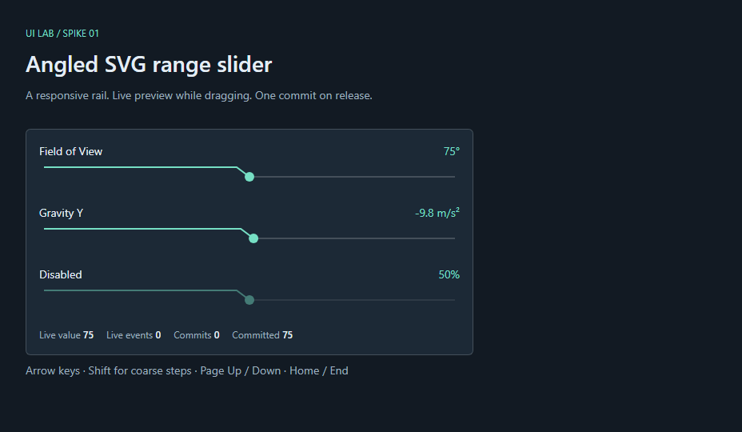

# Angled SVG Range Slider (`<ui--slider>`) Spike — Runbook

## 2026-10-18

### Argon (Gemini 4 Argon) — Plan & Runbook Initialization

- **[action]** Initialized [Plan 03](../plans/03_slider-svg-spike.md) and Runbook 03 for the first `@daxur-studios/ui` control spike: `<ui--slider>` featuring the `¬` (horizontal-then-angled-down) dynamic SVG active track and knob.
- **[decision]** **Spike Hypothesis (`slider-svg-spike`, `#1`):**
  - _"Can a `<ui--slider>` built as a single-tab-stop Angular 20 `OnPush` signal component render a dynamic SVG `¬` (horizontal-then-angled-down) active track path measured via `ResizeObserver`, support pointer-capture dragging and full keyboard navigation (`Arrow`, `Shift+Arrow`, `PageUp/Down`, `Home/End`), and emit separate live `value` updates and terminal `valueCommit` events without layout shift or hardcoded CSS color literals?"_
- **[decision]** **Scope & Architectural Alignment:**
  - Enforces all locked-in rules from [Plan 01](../plans/01_testing-and-architecture-evaluation.md):
    1. Pure TS math and SVG path generator (`slider-math.ts`) tested headlessly in Vitest (`npm test`).
    2. `<ui--slider>` standalone `OnPush` component using Angular 20 signals (`input()`, `model()`, `output()`, `computed()`), `ResizeObserver`, pointer capture, and single-tab-stop `role="slider"` semantics.
    3. Zero hardcoded hex/rgba literals in component SCSS; all styling driven by `--ui-*` tokens with `--mat-sys-*` and Dark HUD fallbacks.
    4. Demo spike registered in `projects/demo/src/app/spikes/spike-registry.ts` (`#1`), verified via Playwright (`e2e/spikes/slider-svg-spike.spec.ts`), and captured with `npm run spikes:thumbnails` per [`docs/standards/spikes.md`](../standards/spikes.md).
- **[next]** Ready for implementation agent to execute the checklist in [Plan 03](../plans/03_slider-svg-spike.md) and append verification evidence below.

### Codex — Implementation and verification

- **[action]** Read `AGENTS.md`, Plan 01 §3, the spikes standard, and Plan/Runbook 03 before writing code. Implemented the pure TypeScript numeric and SVG helpers, standalone OnPush signal slider, lazy spike route, three-control telemetry harness, and registry entry #1 using only the library's public entrypoint.
- **[decision]** Shared `_tokens.scss` supplies private resolved properties using public `--ui-*` → Material adapter → HUD fallback. Public defaults are never assigned on component hosts. The packaged `styles/theme` Sass export provides both explicit HUD scopes; `styles/tokens` exports the shared mixins. Removed optional peer metadata to match Plan 01's required Angular core/common/CDK boundary and updated the bundled library skill with the complete API/theme contract.
- **[decision]** Numeric normalization collapses invalid/reversed ranges to the normalized minimum, uses step 1 for invalid steps, aligns snapping to min, rounds decimal drift to 12 places, and preserves explicit endpoints even when max is off the step lattice. Incoming values are normalized for display/ARIA without emitting an unsolicited model update.
- **[decision]** Pointerdown measures once and captures the primary pointer; moves use cached bounds and emit only changed live values. Up, cancel, capture loss, or disabling close a changed transaction once. A drag returning to its starting value and unchanged keys/clicks produce no commit. The observer refreshes width signals and disconnects on destroy. Component rendering/interaction tests live in Playwright rather than a redundant Node `slider.component.spec.ts`, keeping Vitest DOM-free as agreed in Plan 01.
- **[verification]** `npm test`: **35 passed** on the final run (including concurrent catalog tests), with **29 slider math cases** for bounds, invalid values/steps, negative/decimal stepping, round trips, extreme finite ratios, exact 0/50/100% paths, and zero/narrow dimensions.
- **[verification]** `npm run test:e2e`: **20 passed** across the current workspace, including **12 slider tests**. Assertions cover host display, SVG mutation, ARIA/unit values, Tab/Shift+Tab, all arrows and coarse arrows, PageUp/Down, Home/End, decimal values, disabled interaction, captured out-of-bounds dragging, changed/unchanged clicks, cancellation, unexpected capture loss, return-to-start suppression, resize to a 320 px panel, and both theme scopes/overrides. The drag asserts **more than five live events**, **zero commits before release**, and **exactly one after release**. Instrumentation asserts **zero layout reads during pointermove**; host bounding boxes are identical before/after value updates and dragging.
- **[verification]** `npm run spikes:thumbnails`: **4 passed** (including the concurrently added pipeline safety tests). Generated `projects/demo/public/thumbnails/slider-svg-spike.webp`: **5.7 KB**, below the 40 KB target. The generated WebP stays ignored as specified by the spikes standard.
- **[verification]** `npm run build:ui` and `npx ng build demo --configuration production`: **passed**. The library includes public declarations, Sass assets/exports and bundled skill; the demo keeps the slider page in a lazy chunk (13.54 kB raw in this run). Prettier was run only on this implementation's modified files.
- **[evidence]** Captured and visually inspected the initial 960 × 540 HUD stage: all three sliders, distinct active/inactive rails, downward hooks, readable units and event telemetry fit without clipping. Screenshot: [slider-svg-spike.png](assets/03/slider-svg-spike.png).
- **[finding]** **Passed:** the Angular 20 zoneless harness renders responsive angled SVG tracks, exposes one keyboard tab stop per enabled control, and cleanly separates live previews from terminal commits without observed interaction layout shift or component SCSS color literals. Registry status is set manually to `passed`, and Plan 03's checklist is complete.
- **[scope]** Browser verification uses the repository's configured Chromium project; Firefox/WebKit and assistive-technology testing were not run. The layout-shift evidence is exact pre/post control bounds, not a whole-page performance trace. Decimal normalization retains 12 places. Concurrent catalog/pipeline work and pre-existing plan/index changes were preserved.

### First Spike Reflection (2026-10-18)

- **[finding]** Plan 03 is the library's first UI spike. It proved the slider interaction and token contract; exposed customization includes bounds, step, unit, disabled state, theme tokens, and responsive container width. SVG geometry and density remain internal implementation choices.
- **[decision]** Explore precise entry as a native number input within `<ui--slider>`. Keep its draft text separate from the numeric model; accept a valid value on Enter or blur, discard on Escape, and restore the prior value on invalid blur. A changed accepted value should produce one `valueCommit`; dragging keeps live previews.
- **[decision]** Define compact, comfortable (current), and spacious density presets that coordinate spacing, type, editor padding, track geometry, and interaction area. Do not scale track height alone because that distorts the SVG geometry.
- **[next]** Make editable value entry and density the focus of a follow-up spike. Keep the input native until a second component demonstrates a shared number-input contract; then decide whether to extract `<ui--number>`. This remains a direction for a future hypothesis, not a new plan or API commitment.
